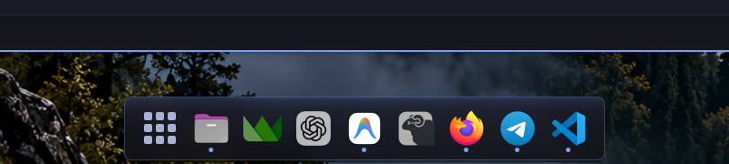

# BetterDock

<p align="center">
  
</p>

An enhanced, theme-matching application dock for [Omarchy](https://omarchy.org) floating workspaces.

Unlike the default fully transparent dock, **BetterDock** features a refined, semi-translucent container that blends seamlessly with your Omarchy system theme, desktop widgets, and color palette.

---

## Features

- **Theme-Integrated Style**: A subtle, semi-translucent dark capsule with an accent-colored border and gentle drop shadow that matches your active Omarchy theme.
- **Smart Auto-Hide**: Automatically tucks completely off-screen under maximized or fullscreen applications. Effortlessly slides into view when the mouse cursor touches the screen edge.
- **Live Position Switching**: Switch dock placement between **Bottom**, **Top**, **Left**, and **Right** on the fly via the right-click settings menu on the apps button.
- **Reliable App Pinning**: Fully supports standard and complex desktop IDs (including apps with reverse-DNS names like Telegram) with drag-and-drop reordering.
- **Integrated App Grid**: Built-in searchable 9-dot launcher to find, run, and pin any installed application.
- **Lightweight & Battery-Friendly**: Built purely with native Qt Quick and Quickshell scene-graph components with zero polling loops.

---

## Installation

Install directly using the Omarchy CLI:

```bash
omarchy plugin add https://github.com/myfryll/betterdock.git --enable
```

If you previously had the default dock enabled, disable it to prevent overlapping:

```bash
omarchy plugin disable omarchy.dock
omarchy restart shell
```

---

## Configuration & Usage

- **Open App Search**: Left-click the 9-dots button on the dock.
- **Dock Settings**: Right-click the 9-dots button to open the settings popup:
  - Change position: **Top**, **Bottom**, **Left**, **Right**
  - Toggle **Auto-hide**
- **Pin / Unpin Apps**: Right-click any app icon in the dock or within the App Grid and select **Keep in Dock** / **Remove from Dock**.
- **CLI Management**:
  ```bash
  omarchy dock position [bottom|top|left|right]
  omarchy dock autohide [on|off|toggle]
  ```

---

## Removal

To completely remove BetterDock:

```bash
omarchy plugin remove myfryll.betterdock
```

---

<details>
<summary><b>🇷🇺 Описание на русском (Russian)</b></summary>

### О плагине BetterDock

**BetterDock** — улучшенная панель приложений для плавающих воркспейсов [Omarchy](https://omarchy.org).

В отличие от стандартного полностью прозрачного дока, BetterDock добавляет аккуратную полупрозрачную подложку в тон системной темы Omarchy с акцентной обводкой и мягкой тенью.

#### Основные возможности
- **Стиль в тон системы**: Полупрозрачная темная капсула с акцентным бордером, идеально гармонирующая с виджетами и темами Omarchy.
- **Умный авто-хайд**: Док полностью скрывается за пределы экрана при разворачивании окна на весь экран и плавно выезжает, когда курсор подводится к кромке монитора.
- **Перемещение на лету**: Переключение расположения панели (**Снизу**, **Сверху**, **Слева**, **Справа**) и авто-скрытия прямо из контекстного меню по правому клику.
- **Надежное прикрепление**: Корректная работа с закреплением любых приложений (включая Telegram).
- **Встроенное меню приложений**: Полноэкранный поиск и запуск программ по кнопке с 9 точками.

#### Установка
```bash
omarchy plugin add https://github.com/myfryll/betterdock.git --enable
```

#### Удаление
```bash
omarchy plugin remove myfryll.betterdock
```

</details>

---

## License

[MIT](LICENSE) © 2026 myfryll
