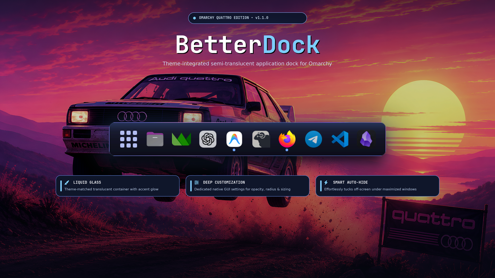

# BetterDock

<p align="center">
  
</p>

An enhanced, theme-matching application dock for [Omarchy](https://omarchy.org) floating workspaces.

Unlike the default fully transparent dock, **BetterDock** features a refined, semi-translucent container that blends seamlessly with your Omarchy system theme, desktop widgets, and color palette.

---

## Features

- **Theme-Integrated Style**: A subtle, semi-translucent dark capsule with an accent-colored border and gentle drop shadow that matches your active Omarchy theme.
- **Dedicated Settings Window**: Configure opacity, corner radius, icon scale, full-width mode, floating island panel, icon alignment, hover magnification, and language (English/Russian) right from a native GUI.
- **Smart Discoverability Tooltip**: Hovering over the 9-dots button reveals a subtle tooltip showing the shortcut to settings.
- **System Search Integration**: Easily discover and open settings from Omarchy's application search (`BetterDock Settings`) or via terminal (`omarchy-dock-settings`).
- **Smart Auto-Hide**: Automatically tucks completely off-screen under maximized or fullscreen applications. Effortlessly slides into view when the mouse cursor touches the screen edge.
- **Live Position Switching**: Switch dock placement between **Bottom**, **Top**, **Left**, and **Right** on the fly via the right-click settings menu on the apps button.
- **Reliable App Pinning**: Fully supports standard and complex desktop IDs (including apps with reverse-DNS names like Telegram) with drag-and-drop reordering.
- **Integrated App Grid**: Built-in searchable 9-dot launcher to find, run, and pin any installed application.
- **Lightweight & Battery-Friendly**: Built purely with native Qt Quick and Quickshell scene-graph components with zero polling loops.

---

## Installation

Install directly using the Omarchy CLI:

```bash
omarchy plugin add https://github.com/myfryll/betterdock.git --enable
```

If you previously had the default dock enabled, disable it to prevent overlapping:

```bash
omarchy plugin disable omarchy.dock
omarchy restart shell
```

---

## Configuration & Usage

### Opening Settings
You can open the graphical settings window in any of three ways:
1. **Right-Click the 9-dots button** on the dock and click **Settings**.
2. **System Search**: Press `Super` (or click the top bar) and type `BetterDock Settings`.
3. **Terminal / CLI**: Run `omarchy-dock-settings`.

### Customization Options
- **Appearance Tab**:
  - **Background Opacity**: Adjust transparency from 10% to 100% (Solid) with live preview on the dock.
  - **Corner Radius**: Choose from Sharp (0px), Subtle (6px), Default (12px), or Round (24px).
  - **Theme Harmony**: Real-time integration with active Omarchy color themes.
- **Layout & Style Tab**:
  - **Dock Size**: Adjust icon scale from compact (28px) to expansive (48px).
  - **Full-Width Bar**: Toggle between a floating capsule and a display-spanning bottom bar.
  - **Floating Island**: Keep rounded capsule aesthetics even in expanded mode.
  - **Icon Alignment**: Align pinned and running items to the **Center** or to the **Left**.
- **Behavior & FX Tab**:
  - **Hover Animation**: Smooth zoom magnification effect when hovering over dock icons.
  - **Zoom Scale**: Adjust magnification strength from Subtle (1.10x) to Dramatic (1.35x).
  - **Auto-Hide on Maximized**: Automatically hide dock when an application is maximized.
  - **Bilingual UI**: Toggle between **English** and **Russian** instantly with the `[ RU | EN ]` switch.

### Quick Context Menu
- Right-click the 9-dots button for quick controls:
  - **Position**: Place dock at **Bottom**, **Top**, **Left**, or **Right**.
  - **Auto-Hide**: Toggle edge-triggered hiding on or off.
  - **Settings**: Open the comprehensive settings dialog.

### App Management & Pinning
- **Open App Search**: Left-click the 9-dots button.
- **Pin / Unpin Apps**: Right-click any app icon in the dock or inside the App Grid and select **Keep in Dock** / **Remove from Dock**.
- **Reorder**: Drag and drop icons along the dock to reorder them.

### CLI Management
```bash
omarchy-dock-settings               # Open graphical settings window
omarchy dock position [bottom|top|left|right]  # Set dock position
omarchy dock autohide [on|off|toggle]          # Toggle auto-hide
```

---

## Removal

To completely remove BetterDock:

```bash
omarchy plugin remove myfryll.betterdock
```

---

<details>
<summary><b>🇷🇺 Описание на русском (Russian)</b></summary>

### О плагине BetterDock

**BetterDock** — улучшенная панель приложений для плавающих воркспейсов [Omarchy](https://omarchy.org).

В отличие от стандартного полностью прозрачного дока, BetterDock добавляет аккуратную полупрозрачную подложку в тон системной темы Omarchy с акцентной обводкой, мягкой тенью и широкими возможностями кастомизации.

---

### Основные возможности

- **Стиль в тон системы**: Полупрозрачная темная капсула с акцентным бордером, идеально гармонирующая с виджетами и темами Omarchy.
- **Полноценное окно настроек**: Графический интерфейс для настройки прозрачности, скругления, масштаба значков, полноразмерного и плавающего режима, выравнивания и эффектов с поддержкой двух языков (EN/RU).
- **Умная подсказка при наведении**: При наведении курсора на кнопку меню приложений (9 точек) показывается аккуратная подсказка о переходе в настройки по правому клику.
- **Интеграция с системным поиском**: Мгновенный запуск настроек через Super-поиск Omarchy (`BetterDock Settings`) или через команду `omarchy-dock-settings`.
- **Умный авто-хайд**: Док полностью скрывается за пределы экрана при разворачивании окна на весь экран и плавно выезжает при подведении курсора к краю монитора.
- **Перемещение на лету**: Переключение расположения панели (**Снизу**, **Сверху**, **Слева**, **Справа**) и авто-скрытия прямо из контекстного меню по правому клику.
- **Надежное прикрепление**: Корректная работа с закреплением любых приложений (включая Telegram и программы со сложными Desktop ID) и сортировка перетаскиванием (drag-and-drop).
- **Встроенное меню приложений**: Полноэкранный поиск и запуск программ по клику на кнопку с 9 точками.
- **Легковесность и автономность**: Написан на чистом Qt Quick и Quickshell без фоновых циклов опроса, экономя ресурс аккумулятора и процессора.

---

### Установка

Установка одной командой через терминал Omarchy CLI:

```bash
omarchy plugin add https://github.com/myfryll/betterdock.git --enable
```

Если ранее использовался стандартный док, отключите его во избежание наложений:

```bash
omarchy plugin disable omarchy.dock
omarchy restart shell
```

---

### Настройка и использование

#### Как открыть настройки
Открыть графическое окно настроек можно любым из трех удобных способов:
1. **Правый клик по кнопке с 9 точками** на доке -> пункт **Settings / Настройки**.
2. **Системный поиск**: Нажмите клавишу `Super` (или кликните по верхней панели) и начните вводить `BetterDock Settings`.
3. **Командная строка**: Выполните `omarchy-dock-settings` в терминале.

#### Доступные параметры кастомизации
- **Вкладка «Внешний вид» (Appearance)**:
  - **Прозрачность фона**: Плавная регулировка от 10% до 100% (Solid) с отображением изменений на живом доке в реальном времени.
  - **Радиус скругления**: Выбор готовых пресетов: Острый (0px), Легкий (6px), Стандартный (12px), Круглый (24px).
  - **Гармония с системой**: Автоматическое считывание цветовой палитры активной темы Omarchy.
- **Вкладка «Расположение и стиль» (Layout & Style)**:
  - **Размер дока**: Настройка масштаба значков от компактного (28px) до крупного (48px).
  - **Во всю ширину**: Переключение между компактной парящей капсулой и широкой панелью во всю ширину экрана.
  - **Парящий остров**: Сохранение скругленных краев капсулы даже в расширенном режиме.
  - **Выравнивание значков**: Размещение приложений по **Центру** или по **Левому краю**.
- **Вкладка «Поведение и эффекты» (Behavior & FX)**:
  - **Анимация при наведении**: Плавное увеличение значка под курсором мыши (zoom effect).
  - **Масштаб зума**: Настройка интенсивности увеличения от Subtle (1.10x) до Dramatic (1.35x).
  - **Скрывать при максимизации**: Автоматическое скрытие дока под развернутыми на весь экран окнами.
  - **Язык интерфейса**: Мгновенное переключение между **Русским** и **Английским** языком кнопкой `[ RU | EN ]` в шапке окна.

#### Быстрое контекстное меню
- При клике правой кнопкой мыши по значку 9 точек доступно меню:
  - **Position**: Перемещение панели (**Bottom**, **Top**, **Left**, **Right**).
  - **Auto-Hide**: Быстрое включение/выключение авто-скрытия.
  - **Settings**: Открытие полного окна настроек.

#### Управление значками и закрепление
- **Меню приложений**: Обычный клик левой кнопкой мыши по значку с 9 точками.
- **Закрепление и открепление**: Кликните правой кнопкой мыши по любой иконке в доке или в меню всех приложений и выберите **Keep in Dock** (Закрепить) / **Remove from Dock** (Убрать).
- **Сортировка**: Просто перетаскивайте значки мышью для изменения порядка.

#### Управление через консоль (CLI)
```bash
omarchy-dock-settings               # Открыть графическое окно настроек
omarchy dock position [bottom|top|left|right]  # Задать расположение панели
omarchy dock autohide [on|off|toggle]          # Включить/выключить авто-скрытие
```

---

### Удаление

Чтобы полностью удалить плагин BetterDock:

```bash
omarchy plugin remove myfryll.betterdock
```

</details>

---

## License

[MIT](LICENSE) © 2026 myfryll
